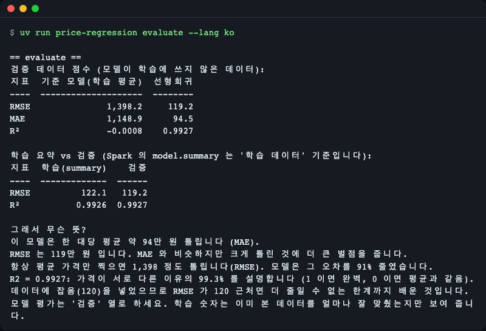
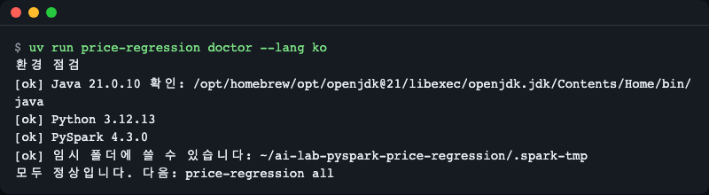
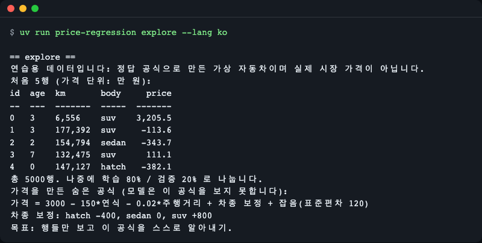
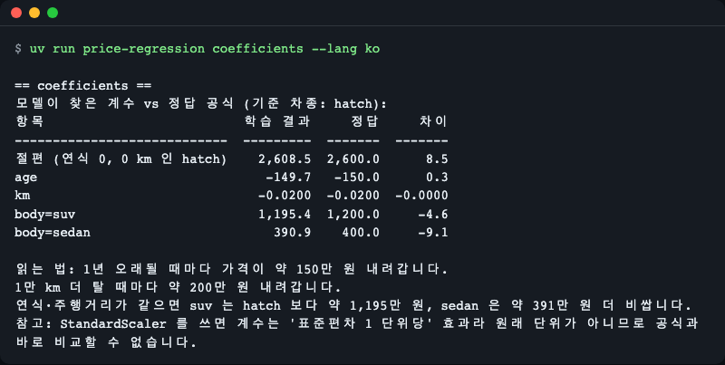
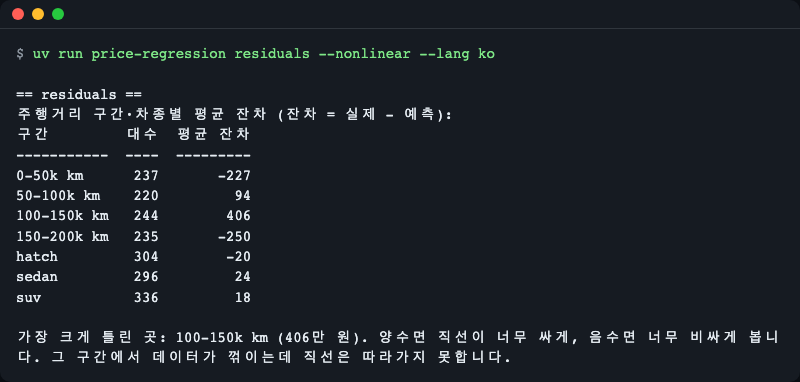
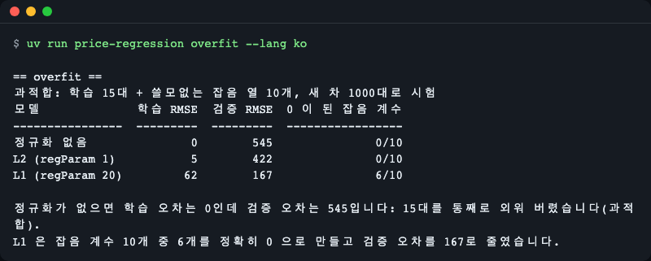
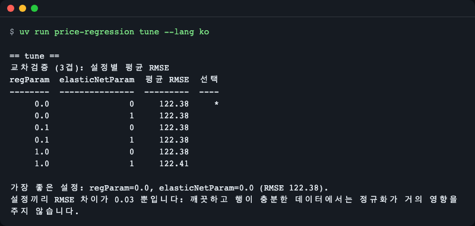
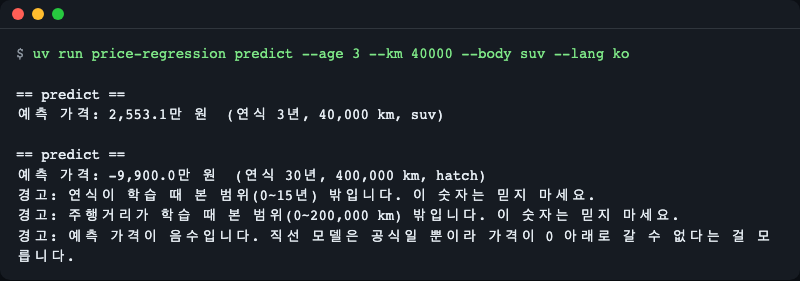
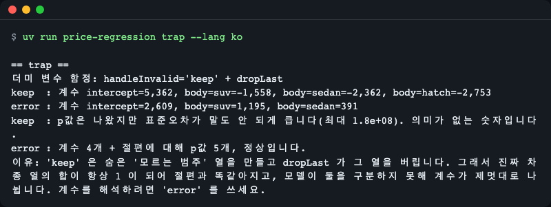
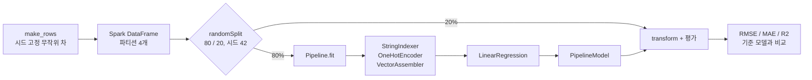

# PySpark MLlib 선형회귀로 중고차 가격 예측하기

[English](README.md) | **한국어**

숫자·범주형 특성으로 PySpark MLlib 회귀 파이프라인을 만들고, 학습/검증 데이터를 나눠 점수(RMSE, MAE, R²)를 읽어 보는 단계별 데모입니다. 데이터는 정답 공식을 아는 합성 데이터라서 모델이 정답을 제대로 배웠는지 직접 확인할 수 있습니다. `uv sync && uv run price-regression all` 로 실행하며 Java 17+ 만 있으면 되고, 네트워크·API 키·데이터셋 내려받기는 필요 없습니다.


<sub>`evaluate` 단계: 학습에 쓰지 않은 차에서 모델이 얼마나 틀리는지를 "항상 평균 가격만 찍기"와 비교합니다.</sub>

## 한 줄 요약

이 데모를 끝까지 따라 하면 Spark 회귀 파이프라인을 만들고, 검증 데이터를 따로 떼어 두고, RMSE / MAE / R² 를 쉬운 말로 읽고, 모델이 외워 버렸는지(과적합)·패턴을 놓쳤는지를 알아챌 수 있습니다.

**이런 분께:** 파이썬을 조금 알고 Spark 로 첫 회귀를 직접 해 보고 싶은 분, pandas·scikit-learn 은 써 봤고 MLlib Pipeline 이 어떻게 다른지 보고 싶은 분, 모델은 만들 줄 알지만 오차 숫자를 읽는 법을 정리하고 싶은 분.

> **중요: 데이터는 가짜입니다.** 모든 차는 `src/price_regression/data.py` 가 숨은 공식에 무작위 잡음을 더해 만듭니다. 가격이 음수로 나오는 행도 있습니다(아래 `explore` 출력 참고). 정답을 알고 있으니 배우기에는 오히려 좋습니다. 하지만 **실제 시장 데이터가 아니며**, 여기서 학습한 모델은 실제 중고차 가격에 대해 아무것도 말해 주지 않습니다. 가격 단위는 만 원입니다(영어 출력의 "x10k KRW"): 3,000 은 3,000만 원입니다.

## 왜 알아야 하나요?

중고차 딜러가 가격표를 만들고 싶다고 해 봅시다. 과거 거래가 수천 건 있고, 오래되고 많이 탄 차일수록 싸게 팔린다는 감이 있습니다. 회귀는 그 감을 공식으로 바꾸는 일입니다. "기본 가격에서 1년마다 이만큼, 1km 마다 저만큼 빼고, SUV 면 보너스를 더한다". 그리고 아직 보지 않은 거래로 공식을 시험합니다. 크게 틀리면 옛 거래에서 아무리 잘 맞았어도 그 공식은 틀린 것입니다. Spark MLlib 도 똑같이 하되, 표가 수백만 행이어도 같은 파이프라인이 돌아갑니다.

## 30초 만에 실행하기

Java 17+ (Spark 는 JVM 위에서 돌아갑니다)와 [uv](https://docs.astral.sh/uv/) (`curl -LsSf https://astral.sh/uv/install.sh | sh`)가 필요합니다. 처음 실행할 때 PySpark 를 내려받으므로 네트워크가 한 번 필요합니다.

| OS | Java 설치 |
|---|---|
| macOS | `brew install openjdk@21` |
| Ubuntu / Debian | `sudo apt install openjdk-21-jre-headless` |
| Windows | `winget install EclipseAdoptium.Temurin.21.JDK` |

```bash
git clone https://github.com/LeeGyeongPil/ai-lab-pyspark-price-regression.git
cd ai-lab-pyspark-price-regression
uv sync
uv run price-regression doctor   # Java, Python, PySpark, 임시 폴더 확인
uv run price-regression all      # 모든 단계 실행, 약 15초
```


<sub>`doctor` 는 요건마다 `[ok]` 를 찍습니다. Java 가 없으면 위의 설치 명령을 안내하고 종료 코드 2 로 끝납니다.</sub>

Spark 가 시작될 때 `WARNING: Using incubator modules: jdk.incubator.vector`, `Setting default log level to "WARN"` 같은 줄이 stderr 에 나올 수 있습니다. 정상입니다. 데모가 로그를 조용히 만들기 전에 JVM 이 먼저 찍는 줄입니다.

확인한 버전(2026-11-15): Python 3.12.13, PySpark 4.3.0, OpenJDK 21.0.10.

**화면 언어:** `--lang en` 또는 `--lang ko`. 지정하지 않으면 `PRICE_REGRESSION_LANG`, 그다음 `LC_ALL` / `LANG` 을 보고, 그래도 모르면 영어입니다. 시스템 언어가 한국어면 `--lang en` 을 주지 않는 한 한국어로 나옵니다. 이 문서의 출력은 모두 `--lang ko` 로 얻은 것이며, 명령은 짧게 보이려고 `--lang` 을 생략했습니다.

## 단계별로 따라 하기

단계마다 독립된 명령이라 하나만 실행해도 됩니다. `--rows 2000` 을 붙이면 더 빠르고, `--seed N` 은 무작위 데이터를 바꾸며, `--lang en` 은 영어 출력입니다.

### 1단계. 데이터 살펴보기 (`explore`)

```bash
uv run price-regression explore
```

```text
== explore ==
연습용 데이터입니다: 정답 공식으로 만든 가상 자동차이며 실제 시장 가격이 아닙니다.
처음 5행 (가격 단위: 만 원):
id  age  km       body     price
--  ---  -------  -----  -------
0   3    6,556    suv    3,205.5
1   3    177,392  suv     -113.6
2   2    154,794  sedan   -343.7
3   7    132,475  suv      111.1
4   0    147,127  hatch   -382.1
총 5000행. 나중에 학습 80% / 검증 20% 로 나눕니다.
가격을 만든 숨은 공식 (모델은 이 공식을 보지 못합니다):
가격 = 3000 - 150*연식 - 0.02*주행거리 + 차종 보정 + 잡음(표준편차 120)
차종 보정: hatch -400, sedan 0, suv +800
목표: 행들만 보고 이 공식을 스스로 알아내기.
```


<sub>처음 몇 행과 숨은 공식. `age`, `km`, `body` 열은 **특성**(입력)이고 `price` 는 **라벨**(맞혀야 할 정답)입니다.</sub>

무슨 뜻인가요: 한 행이 차 한 대입니다. `age`, `km` 는 숫자이고, `body` 는 범주(hatch / sedan / suv)라서 모델이 글자 그대로는 쓸 수 없습니다. 목표는 행들만 보고 공식을 되찾는 것입니다.

### 2단계. 나누고 파이프라인 만들기 (`train`)

```bash
uv run price-regression train
```

```text
== train ==
시드 42 로 분리: 학습 4064행, 검증 936행 (80% / 20%).
Pipeline 단계: StringIndexerModel -> OneHotEncoderModel -> VectorAssembler -> LinearRegressionModel
차종 순서 [suv, sedan, hatch]. 마지막(hatch)이 기준 범주입니다.
학습 시간 0.9초.
```

무슨 뜻인가요:

- **학습/검증 분리.** `randomSplit([0.8, 0.2], seed=42)` 가 차의 20% 를 따로 떼어 둡니다. 모델은 학습하는 동안 이 차들을 보지 못하므로 공정한 시험이 됩니다. 시드가 같으면 매번 같은 분리가 나옵니다.
- **Pipeline.** 네 단계가 이어집니다. `StringIndexer` 는 `suv/sedan/hatch` 를 0/1/2 로 바꾸고(alphabetDesc 순서, 코드 둘러보기 참고), `OneHotEncoder` 는 각 숫자를 차종별 0/1 열로 바꾸며(한 종류는 기준으로 빼 둡니다, 4단계 참고), `VectorAssembler` 는 `age`, `km`, 차종 열을 `features` 열 하나로 묶고, `LinearRegression` 이 공식을 맞춥니다.
- 데이터를 바꾸기만 하는 단계는 **Transformer**, 먼저 데이터에서 배워야 하는 단계는 **Estimator** 입니다. `fit` 하면 Estimator 가 Transformer(위의 "...Model")가 됩니다.

### 3단계. 점수 읽기 (`evaluate`)

```bash
uv run price-regression evaluate
```

```text
== evaluate ==
검증 데이터 점수 (모델이 학습에 쓰지 않은 데이터):
지표  기준 모델(학습 평균)  선형회귀
----  --------------------  --------
RMSE               1,398.2     119.2
MAE                1,148.9      94.5
R²                 -0.0008    0.9927

학습 요약 vs 검증 (Spark 의 model.summary 는 '학습 데이터' 기준입니다):
지표  학습(summary)    검증
----  -------------  ------
RMSE          122.1   119.2
R²           0.9926  0.9927

그래서 무슨 뜻?
이 모델은 한 대당 평균 약 94만 원 틀립니다 (MAE).
RMSE 는 119만 원 입니다. MAE 와 비슷하지만 크게 틀린 것에 더 큰 벌점을 줍니다.
항상 평균 가격만 찍으면 1,398 정도 틀립니다(RMSE). 모델은 그 오차를 91% 줄였습니다.
R2 = 0.9927: 가격이 서로 다른 이유의 99.3% 를 설명합니다 (1 이면 완벽, 0 이면 평균과 같음).
데이터에 잡음(120)을 넣었으므로 RMSE 가 120 근처면 더 줄일 수 없는 한계까지 배운 것입니다.
모델 평가는 '검증' 열로 하세요. 학습 숫자는 이미 본 데이터를 얼마나 잘 맞췄는지만 보여 줍니다.
```

무슨 뜻인가요:

- **MAE**(평균 절대 오차): 틀린 크기의 평균. 94.5 는 한 대당 약 94.5만 원입니다.
- **RMSE**(평균 제곱근 오차): MAE 와 비슷하지만 틀린 크기를 먼저 제곱하므로 크게 틀린 몇 대가 더 아프게 반영됩니다.
- **R²**: 가격 차이 중 모델이 설명하는 비율. 1 이면 완벽, 0 이면 평균을 찍는 것과 같습니다.
- **기준 모델.** 점수 하나만으로는 좋은지 판단하기 어렵습니다. "항상 학습 평균을 찍기"가 가장 단순한 모델이라 이것과 비교합니다. R² 는 약 0 입니다.
- Spark 의 `model.summary` 는 **학습** 데이터 기준입니다. 모델은 검증 열로 평가하세요.

### 4단계. 모델이 무엇을 배웠나 확인 (`coefficients`)

```bash
uv run price-regression coefficients
```

```text
== coefficients ==
모델이 찾은 계수 vs 정답 공식 (기준 차종: hatch):
항목                          학습 결과     정답     차이
----------------------------  ---------  -------  -------
절편 (연식 0, 0 km 인 hatch)    2,608.5  2,600.0      8.5
age                              -149.7   -150.0      0.3
km                              -0.0200  -0.0200  -0.0000
body=suv                        1,195.4  1,200.0     -4.6
body=sedan                        390.9    400.0     -9.1

읽는 법: 1년 오래될 때마다 가격이 약 150만 원 내려갑니다.
1만 km 더 탈 때마다 약 200만 원 내려갑니다.
연식·주행거리가 같으면 suv 는 hatch 보다 약 1,195만 원, sedan 은 약 391만 원 더 비쌉니다.
참고: StandardScaler 를 쓰면 계수는 '표준편차 1 단위당' 효과라 원래 단위가 아니므로 공식과 바로 비교할 수 없습니다.
```


<sub>학습한 값과 정답이 잡음 범위 안에서 일치합니다. 공식을 아는 데이터로 만들었기 때문에 가능한 확인입니다.</sub>

무슨 뜻인가요: **계수**는 "이 특성이 한 단위 늘 때 가격이 얼마나 움직이나"입니다. 공식의 원래 절편은 sedan 기준 3000 인데, 이 데모는 `hatch` 를 **기준 범주**로 삼아 공식을 다시 써서 2600(3000 - 400)이 됩니다. 원-핫 인코딩에서는 한 범주를 빼야 하고(`dropLast`), 나머지 차종은 "hatch 보다 얼마나 더"로 읽습니다.

### 5단계. 직선이 틀리는 곳 찾기 (`residuals`)

**잔차**는 `실제 - 예측` 입니다. 모델이 어디서나 평균적으로 맞으면 모든 그룹에서 잔차 평균이 0 근처입니다. 여기서는 휘어진 데이터로 바꿉니다. `--nonlinear` 는 150,000km 를 넘으면 가격이 더 빨리 떨어지게 해서 직선이 따라갈 수 없는 패턴을 만듭니다.

```bash
uv run price-regression residuals --nonlinear
```

```text
== residuals ==
주행거리 구간·차종별 평균 잔차 (잔차 = 실제 - 예측):
구간         대수  평균 잔차
-----------  ----  ---------
0-50k km      237       -227
50-100k km    220         94
100-150k km   244        406
150-200k km   235       -250
hatch         304        -20
sedan         296         24
suv           336         18

가장 크게 틀린 곳: 100-150k km (406만 원). 양수면 직선이 너무 싸게, 음수면 너무 비싸게 봅니다. 그 구간에서 데이터가 꺾이는데 직선은 따라가지 못합니다.
```


<sub>휘어진 데이터에서는 RMSE 만 보면 괜찮아 보여도 주행거리 구간별 잔차가 큽니다. `--nonlinear` 없이는 모든 그룹이 약 15 이내입니다.</sub>

무슨 뜻인가요: 전체 점수가 좋아도 모델이 꾸준히 틀리는 그룹이 숨어 있을 수 있습니다. 총합만 보지 말고 그룹별 오차를 보세요.

### 6단계. 과적합과 정규화 (`overfit`)

```bash
uv run price-regression overfit
```

```text
== overfit ==
과적합: 학습 15대 + 쓸모없는 잡음 열 10개, 새 차 1000대로 시험
모델              학습 RMSE  검증 RMSE  0 이 된 잡음 계수
----------------  ---------  ---------  -----------------
정규화 없음               0        545               0/10
L2 (regParam 1)           5        422               0/10
L1 (regParam 20)         62        167               6/10

정규화가 없으면 학습 오차는 0인데 검증 오차는 545입니다: 15대를 통째로 외워 버렸습니다(과적합).
L1 은 잡음 계수 10개 중 6개를 정확히 0 으로 만들고 검증 오차를 167로 줄였습니다.
```


<sub>15대와 미지수 15개(age, km, 차종 열 2개, 잡음 열 10개, 절편)면 모델이 전부 외울 수 있습니다: 학습 오차 0, 검증 오차 545.</sub>

무슨 뜻인가요: **과적합**은 패턴을 배우지 않고 학습 행을 외우는 것입니다. **정규화**(`regParam`)는 계수가 커지는 것에 벌점을 줍니다. **L1** 은 쓸모없는 계수를 정확히 0 으로 만들 수 있고, **L2** 는 줄이기만 합니다. L1 값 20 은 시드 42 로 0.5~50 을 훑어 정했습니다. 다른 데이터에서는 다른 값이 필요할 수 있습니다.

### 7단계. 교차검증으로 설정 고르기 (`tune`)

```bash
uv run price-regression tune
```

```text
== tune ==
교차검증 (3겹): 설정별 평균 RMSE
regParam  elasticNetParam  평균 RMSE  선택
--------  ---------------  ---------  ----
     0.0                0     122.38     *
     0.0                1     122.38
     0.1                0     122.38
     0.1                1     122.38
     1.0                0     122.38
     1.0                1     122.41

가장 좋은 설정: regParam=0.0, elasticNetParam=0.0 (RMSE 122.38).
설정끼리 RMSE 차이가 0.03 뿐입니다: 깨끗하고 행이 충분한 데이터에서는 정규화가 거의 영향을 주지 않습니다.
```


<sub>`CrossValidator` 가 학습 데이터를 3겹으로 나눠 설정마다 시험합니다. 여기서는 여섯 개가 거의 같습니다.</sub>

무슨 뜻인가요: **교차검증**은 학습 데이터를 여러 겹으로 나눠 일부로 학습하고 나머지로 점수를 매긴 뒤 평균을 냅니다. `tune` 은 결과를 솔직하게 보여 줍니다. 깨끗한 5,000행에서는 설정 선택이 거의 영향을 주지 않습니다. 정말 고민될 때 쓰고, 행이 적거나 특성이 많으면 더 큰 차이를 기대하세요.

### 8단계. 새 차 예측과 한계 알기 (`predict`)

```bash
uv run price-regression predict --age 3 --km 40000 --body suv
uv run price-regression predict --age 3 --km 40000 --body tractor
uv run price-regression predict --age 30 --km 400000 --body hatch
```

```text
== predict ==
artifacts/model 에 저장된 모델이 없어 먼저 학습합니다 (시드 42, 5000행)...
예측 가격: 2,553.1만 원  (연식 3년, 40,000 km, suv)
```

```text
== predict ==
모르는 차종 'tractor': 학습할 때 본 적이 없습니다. 다음 중에서 고르세요: suv, sedan, hatch.
```

(종료 코드 3)

```text
== predict ==
예측 가격: -9,900.0만 원  (연식 30년, 400,000 km, hatch)
경고: 연식이 학습 때 본 범위(0~15년) 밖입니다. 이 숫자는 믿지 마세요.
경고: 주행거리가 학습 때 본 범위(0~200,000 km) 밖입니다. 이 숫자는 믿지 마세요.
경고: 예측 가격이 음수입니다. 직선 모델은 공식일 뿐이라 가격이 0 아래로 갈 수 없다는 걸 모릅니다.
```


<sub>정상 예측, 그리고 학습 범위를 한참 벗어난 요청이 음수 가격과 경고를 내는 모습.</sub>

무슨 뜻인가요: 첫 호출은 학습해서 `artifacts/model` 에 저장하고, 이후 호출은 그 모델을 불러옵니다. 모델이 저장된 뒤에는 `--seed`·`--rows`·`--nonlinear` 가 `predict` 에 적용되지 않으며, 저장된 모델의 학습 옵션과 다르면 그 옵션과 다시 학습하려면 지울 폴더를 알려 주는 한 줄이 나옵니다. `저장된 모델이 없어` 안내 줄은 저장된 모델이 아직 없을 때만 나옵니다. `all` 이 이미 모델을 저장하므로 빠른 시작 뒤에는 보이지 않습니다. 모델은 본 것만 압니다. 처음 보는 차종은 거절하고, 학습 범위를 한참 벗어난 차는 자신 있는 답 대신 경고가 붙은 숫자를 줍니다.

### 보너스: 더미 변수 함정 (`trap`)

```bash
uv run price-regression trap
```

```text
== trap ==
더미 변수 함정: handleInvalid='keep' + dropLast
keep  : 계수 intercept=5,362, body=suv=-1,558, body=sedan=-2,362, body=hatch=-2,753
error : 계수 intercept=2,609, body=suv=1,195, body=sedan=391
keep  : p값은 나왔지만 표준오차가 말도 안 되게 큽니다(최대 1.8e+08). 의미가 없는 숫자입니다.
error : 계수 4개 + 절편에 대해 p값 5개, 정상입니다.
이유: 'keep' 은 숨은 '모르는 범주' 열을 만들고 dropLast 가 그 열을 버립니다. 그래서 진짜 차종 열의 합이 항상 1 이 되어 절편과 똑같아지고, 모델이 둘을 구분하지 못해 계수가 제멋대로 나뉩니다. 계수를 해석하려면 'error' 를 쓰세요.
```


<sub>같은 데이터, 두 설정: `keep` 이면 계수가 제멋대로이고 `error` 이면 공식과 맞습니다.</sub>

무슨 뜻인가요: `handleInvalid="keep"` 이면 인덱서가 숨은 범주를 하나 더 만들고, `dropLast` 가 진짜 차종 대신 그 범주를 버립니다. 남은 열들의 합이 절편 열과 같아져 모델이 구분하지 못합니다. 데이터와 Spark 가 작업을 나누는 방식에 따라 이상한 숫자 대신 Spark 가 `No p-value available` 예외를 낼 수도 있는데, 둘 다 같은 뜻입니다. 이 데모의 파이프라인은 `error` 를 씁니다.

## 어떻게 동작하나요?



1. `make_rows` 는 순수 파이썬 `random.Random(seed)` 로 차를 만들어서 데이터가 Spark 의 무작위성에 기대지 않습니다.
2. 행을 파티션 4개로 고정한 Spark DataFrame 으로 만들면 어느 컴퓨터에서나 `randomSplit` 이 같은 분리를 냅니다.
3. 행의 80% 로 파이프라인을 학습하고 20% 는 따로 둡니다.
4. 앞의 세 단계가 특성을 준비하고, `LinearRegression` 이 계수를 배웁니다.
5. 학습된 `PipelineModel` 이 따로 둔 차를 예측하고, 지표를 "학습 평균" 기준 모델과 비교합니다.

## 코드 둘러보기

| 파일 | 하는 일 |
|---|---|
| [`src/price_regression/data.py`](src/price_regression/data.py) | 숨은 공식과 합성 데이터 생성기 |
| [`src/price_regression/pipeline.py`](src/price_regression/pipeline.py) | Pipeline 과 학습/검증 분리 |
| [`src/price_regression/evaluate.py`](src/price_regression/evaluate.py) | RMSE / MAE / R² 와 기준 모델 |
| [`src/price_regression/experiments.py`](src/price_regression/experiments.py) | 과적합, 교차검증, 더미 변수 함정 |
| [`src/price_regression/steps.py`](src/price_regression/steps.py) | 명령마다 함수 하나 |
| [`src/price_regression/i18n.py`](src/price_regression/i18n.py) | 영어·한국어 화면 문구를 한곳에 |

읽어 볼 만한 세 곳:

```python
# pipeline.py - 기준 범주를 "가장 흔한 것" 이 아니라 고정한다
StringIndexer(inputCol="body", outputCol="body_idx",
              stringOrderType="alphabetDesc", handleInvalid=handle_invalid)
```

Spark 는 기본으로 빈도순으로 범주를 늘어놓고 마지막을 버리기 때문에, 데이터에 따라 기준 범주가 바뀝니다. `alphabetDesc` 는 항상 [suv, sedan, hatch] 라서 `hatch` 가 늘 기준이고 계수를 비교할 수 있습니다.

```python
# pipeline.py - 같은 시드, 같은 분리
train, test = df.randomSplit([0.8, 0.2], seed=seed)
```

```python
# evaluate.py - 기준 모델: 항상 '학습' 평균 가격을 예측
mean_price = float(train.agg(F.avg(LABEL)).first()[0])
```

## 용어 사전

| 용어 | 뜻 |
|---|---|
| 특성(Feature) | 모델이 쓰는 입력 열 (`age`, `km`, `body`) |
| 라벨(Label) | 맞혀야 할 값 (`price`) |
| 학습/검증 분리 | 데이터 일부로 배우고, 모델이 보지 못한 나머지로 점수 매기기 |
| Transformer | 데이터를 바꾸는 파이프라인 단계 |
| Estimator | 데이터에서 배워(`fit`) Transformer 를 만드는 단계 |
| Pipeline | 학습과 예측이 같은 단계를 거치도록 이어 붙인 것 |
| 원-핫 인코딩 | 범주를 범주마다 0/1 열로 바꾸기 |
| 기준 범주 | 빼 놓은 범주. 나머지는 이것과 비교해 읽는다 |
| 계수 | 특성이 한 단위 늘 때 예측이 변하는 크기 |
| MAE / RMSE | 평균 오차 크기. RMSE 는 크게 틀린 것을 더 벌준다 |
| R² | 차이를 설명하는 비율. 1 이 완벽, 0 이면 평균과 같다 |
| 기준 모델(Baseline) | 척도로 쓰는 단순한 모델 (학습 평균) |
| 잔차 | 실제 - 예측 |
| 과적합 | 학습 데이터를 외워 새 데이터에서 틀리는 것 |
| 정규화 | 큰 계수에 주는 벌점 (L1 은 0 으로, L2 는 줄이기만) |
| 교차검증 | 설정마다 여러 학습/검증 겹으로 점수 매기기 |

## 직접 바꿔 보기

1. **데이터 줄이기** — `uv run price-regression evaluate --rows 300 --lang ko` 을 실행하고, `--seed 1`, `--seed 2` 로 다시 실행합니다. 예상: 검증 RMSE 가 120 근처에서 시드마다 달라집니다(132.4, 121.0, 121.2 가 나왔습니다). 검증 차가 60대뿐이라 시험이 흔들리기 때문입니다. `선형회귀` 열의 `RMSE` 행으로 확인합니다.
2. **휘어진 데이터** — `uv run price-regression evaluate --nonlinear --lang ko` 을 실행합니다. 예상: 이전보다 점수가 많이 나빠집니다(검증 RMSE 386.9, R² 0.9498 이 나왔고, 원래는 119.2 와 0.9927). 이어서 `residuals --nonlinear` 로 어디서 틀리는지 봅니다.
3. **다른 차종 예측** — 8단계와 같은 연식·주행거리로 `--body sedan`, `--body hatch` 를 예측합니다. 예상: 1,748.6 과 1,357.7 이 나오고, SUV 의 2,553.1 보다 각각 약 805, 1,196 낮습니다. 4단계의 `body=sedan`, `body=suv` 계수와 맞습니다.

## 자주 겪는 문제

| 증상 | 원인 | 해결 |
|---|---|---|
| `Java 17 이상을 찾지 못했습니다`(영어 화면: `Java 17 or newer was not found`)와 종료 코드 2 | Java 가 없거나 경로에 없음 | Java 17+ 를 설치(위 표)하고 `doctor` 를 다시 실행. Java 가 특이한 곳에 있으면 `JAVA_HOME` 지정 |
| `JAVA_GATEWAY_EXITED` | JVM 이 임시 폴더에 쓰지 못함 | 데모는 현재 폴더의 `.spark-tmp/` 를 쓰므로 쓸 수 있는지 확인하거나, `SPARK_LOCAL_DIRS` 를 쓸 수 있는 폴더로 지정 |
| `--age 는 유한한 숫자여야 합니다 (입력값 nan)`(영어 화면: `--age must be a finite number (got nan)`)와 종료 코드 3 | `predict` 가 `nan`·`inf` 입력을 Spark 시작 전에 거부함 | `--age 3 --km 40000` 처럼 일반 숫자를 넣기 |
| Spark 시작할 때 경고가 나옴 | 로그 설정 전에 JVM 이 찍는 줄 | 정상이니 무시 |
| `numpy` 가져오기 오류 | MLlib 에 numpy 가 필요 | extra 와 함께 설치: `pyspark[ml]` (`pyproject.toml` 에 이미 있음, `uv sync` 사용) |
| uv 가 Python 3.15 를 고름 | 아주 새 Python 은 아직 지원하지 않음 | 레포가 `.python-version` 에 3.12 를 고정함. 레포 폴더에서 `uv sync` |
| 직접 한 실험에서 `No p-value available` | 겹치는 열이 있는 선형 모델 | `trap` 단계 참고 |
| 공유 컴퓨터에서 느림 | Spark 가 모든 코어를 씀 | `--rows 1000` 추가 |

## 더 알아보기

- [Spark MLlib: Linear regression](https://spark.apache.org/docs/latest/ml-classification-regression.html#linear-regression) (확인 2026-11-15)
- [Spark MLlib: Pipelines](https://spark.apache.org/docs/latest/ml-pipeline.html) (확인 2026-11-15)
- [Spark MLlib: Feature transformers (StringIndexer, OneHotEncoder, VectorAssembler)](https://spark.apache.org/docs/latest/ml-features.html) (확인 2026-11-15)
- [Spark MLlib: Model selection and tuning (CrossValidator)](https://spark.apache.org/docs/latest/ml-tuning.html) (확인 2026-11-15)
- [PyPI 의 PySpark 4.3.0](https://pypi.org/project/pyspark/) (확인 2026-11-15)

## 라이선스

MIT, [LICENSE](LICENSE) 참고. 모든 데이터는 이 레포의 코드가 만들며 내려받는 것은 없습니다.
