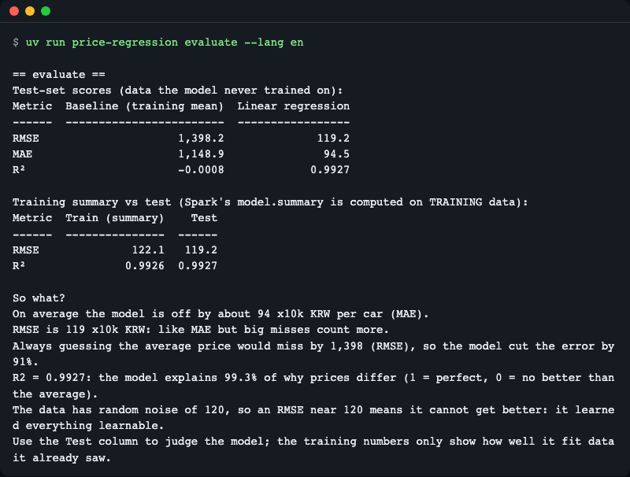
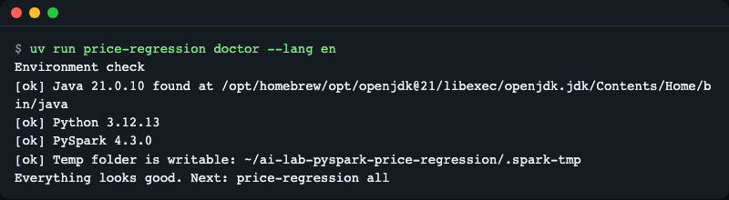
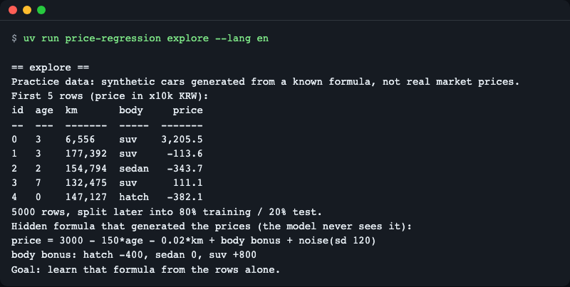
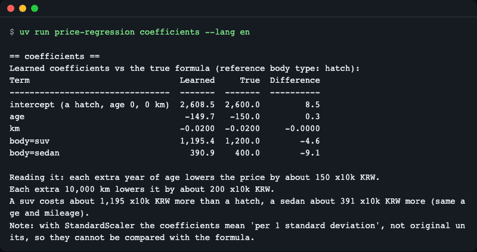
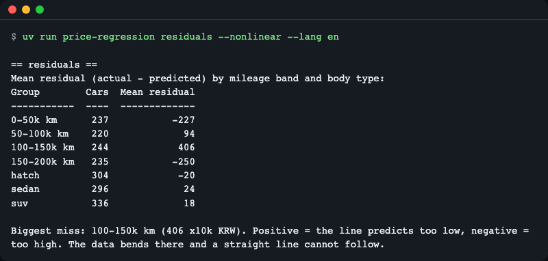
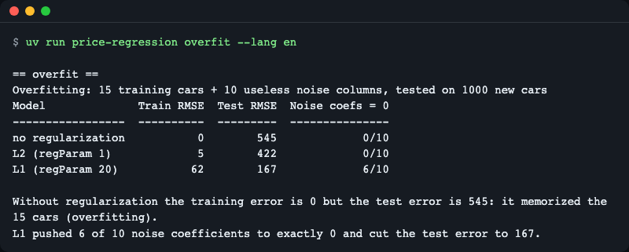
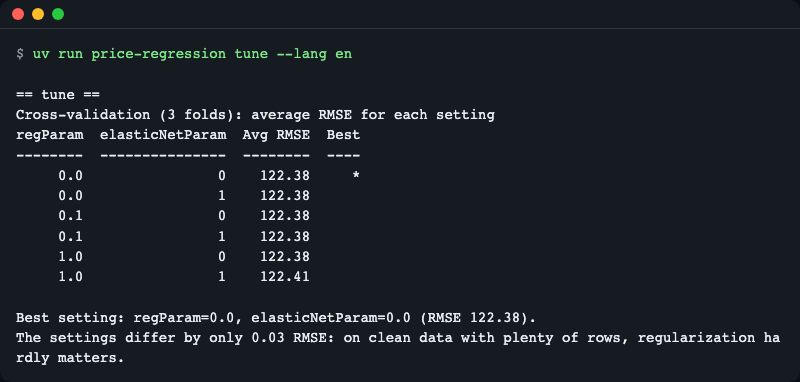
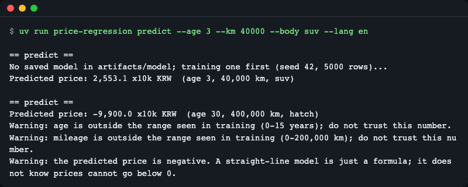
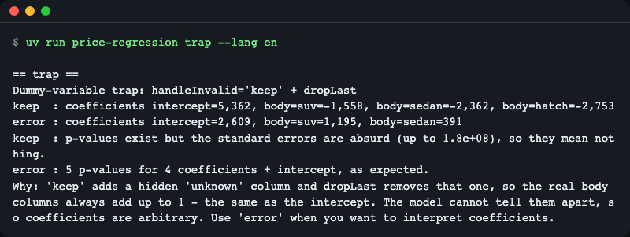
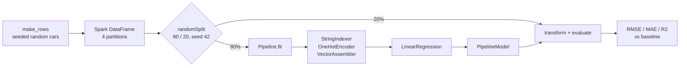

# Predict used-car prices with PySpark MLlib linear regression

**English** | [한국어](README.ko.md)

A step-by-step demo that builds a PySpark MLlib regression pipeline (categorical + numeric features), splits data into training and test sets, and reads the scores (RMSE, MAE, R²). The data is synthetic and generated from a formula we know, so you can check whether the model learned the right answer. Run `uv sync && uv run price-regression all`; it needs Java 17+ and no network, API key, or dataset download.


<sub>The `evaluate` step: how far off the model is on cars it never trained on, compared with "always guess the average price".</sub>

## One-line summary

Follow this demo to the end and you can build a Spark regression pipeline, hold out test data, read RMSE / MAE / R² in plain language, and spot when a model is cheating (overfitting) or missing a pattern.

**For you if:** you know a little Python and want a hands-on first regression in Spark; you have used pandas or scikit-learn and want to see how MLlib's Pipeline differs; you can already train a model but want a clearer way to read its error numbers.

> **Important: the data is made up.** Every car is generated by `src/price_regression/data.py` from a hidden formula plus random noise. Some prices even come out negative (see the `explore` output below). That is fine for learning, because we know the right answer. It is **not** real market data, and a model trained here says nothing about real car prices. Prices are in units of 10,000 KRW ("x10k KRW"): 3,000 means 30,000,000 KRW.

## Why does this matter?

Imagine a used-car dealer who wants a price list. The dealer has thousands of past sales and notices that older, higher-mileage cars sell for less. Regression is the habit of turning that hunch into a formula: "start at some base price, subtract this much per year of age, subtract that much per kilometre, add a bonus for an SUV". Then the dealer tests the formula on sales it has not looked at yet. If it misses by a lot, the formula is wrong, however good it looked on the old sales. Spark MLlib does the same thing, but its pipeline keeps working when the table has millions of rows.

## Run it in 30 seconds

You need Java 17+ (Spark runs on the JVM) and [uv](https://docs.astral.sh/uv/) (`curl -LsSf https://astral.sh/uv/install.sh | sh`). The first run downloads PySpark, so it needs the network once.

| OS | Install Java |
|---|---|
| macOS | `brew install openjdk@21` |
| Ubuntu / Debian | `sudo apt install openjdk-21-jre-headless` |
| Windows | `winget install EclipseAdoptium.Temurin.21.JDK` |

```bash
git clone https://github.com/LeeGyeongPil/ai-lab-pyspark-price-regression.git
cd ai-lab-pyspark-price-regression
uv sync
uv run price-regression doctor   # checks Java, Python, PySpark, temp folder
uv run price-regression all      # runs every step, about 15 seconds
```


<sub>`doctor` prints `[ok]` for each requirement. If Java is missing it prints the install commands above and exits with code 2.</sub>

When Spark starts, it may print a few lines to stderr such as `WARNING: Using incubator modules: jdk.incubator.vector` and `Setting default log level to "WARN"`. These are normal; they come from the JVM before this demo can silence it.

Versions checked on 2026-11-15: Python 3.12.13, PySpark 4.3.0, OpenJDK 21.0.10.

**Screen language:** `--lang en` or `--lang ko`. Without it the demo uses `PRICE_REGRESSION_LANG`, then `LC_ALL` / `LANG`, and falls back to English. On a system set to Korean you therefore get Korean output unless you pass `--lang en`. All outputs in this README were captured with `--lang en`; the commands are shown without it to keep them short.

## Follow along step by step

Each step is its own command, so you can run just one. Add `--rows 2000` to make everything faster, `--seed N` to change the random data, and `--lang ko` for Korean.

### Step 1. Look at the data (`explore`)

```bash
uv run price-regression explore
```

```text
== explore ==
Practice data: synthetic cars generated from a known formula, not real market prices.
First 5 rows (price in x10k KRW):
id  age  km       body     price
--  ---  -------  -----  -------
0   3    6,556    suv    3,205.5
1   3    177,392  suv     -113.6
2   2    154,794  sedan   -343.7
3   7    132,475  suv      111.1
4   0    147,127  hatch   -382.1
5000 rows, split later into 80% training / 20% test.
Hidden formula that generated the prices (the model never sees it):
price = 3000 - 150*age - 0.02*km + body bonus + noise(sd 120)
body bonus: hatch -400, sedan 0, suv +800
Goal: learn that formula from the rows alone.
```


<sub>The first rows and the hidden formula. The columns `age`, `km` and `body` are **features** (inputs); `price` is the **label** (the answer to predict).</sub>

What it means: a row is one car. `age` and `km` are numbers; `body` is a category (hatch / sedan / suv), which a model cannot use as text. The goal is to recover the formula from the rows alone.

### Step 2. Split, then build the pipeline (`train`)

```bash
uv run price-regression train
```

```text
== train ==
Split with seed 42: 4064 training rows, 936 test rows (80% / 20%).
Pipeline stages: StringIndexerModel -> OneHotEncoderModel -> VectorAssembler -> LinearRegressionModel
Body order [suv, sedan, hatch]; the last one (hatch) is the reference category.
Fitted in 1.0 s.
```

What it means:

- **Train/test split.** `randomSplit([0.8, 0.2], seed=42)` sets 20% of the cars aside. The model never sees them while learning, so they act as a fair exam. The same seed gives the same split every time.
- **Pipeline.** Four stages in a row. `StringIndexer` turns `suv/sedan/hatch` into 0/1/2 (alphabetDesc order, see Code tour). `OneHotEncoder` turns each number into a 0/1 column per body type (one type is dropped as the reference, see Step 4). `VectorAssembler` packs `age`, `km` and the body columns into a single `features` column. `LinearRegression` fits the formula.
- A stage that only transforms data is a **Transformer**. A stage that must learn from data first is an **Estimator**; after `fit` it becomes a Transformer (the "...Model" names above).

### Step 3. Read the scores (`evaluate`)

```bash
uv run price-regression evaluate
```

```text
== evaluate ==
Test-set scores (data the model never trained on):
Metric  Baseline (training mean)  Linear regression
------  ------------------------  -----------------
RMSE                     1,398.2              119.2
MAE                      1,148.9               94.5
R²                       -0.0008             0.9927

Training summary vs test (Spark's model.summary is computed on TRAINING data):
Metric  Train (summary)    Test
------  ---------------  ------
RMSE              122.1   119.2
R²               0.9926  0.9927

So what?
On average the model is off by about 94 x10k KRW per car (MAE).
RMSE is 119 x10k KRW: like MAE but big misses count more.
Always guessing the average price would miss by 1,398 (RMSE), so the model cut the error by 91%.
R2 = 0.9927: the model explains 99.3% of why prices differ (1 = perfect, 0 = no better than the average).
The data has random noise of 120, so an RMSE near 120 means it cannot get better: it learned everything learnable.
Use the Test column to judge the model; the training numbers only show how well it fit data it already saw.
```

What it means:

- **MAE** (mean absolute error): the average size of the miss. 94.5 x10k KRW is about 945,000 KRW per car.
- **RMSE** (root mean squared error): like MAE, but squares the misses first, so a few big misses hurt more.
- **R²**: the share of price differences the model explains. 1 is perfect; 0 means no better than guessing the average.
- **Baseline.** A score alone is hard to judge. "Always guess the training average" is the simplest model, so we compare against it. Its R² is about 0.
- `model.summary` in Spark is computed on the **training** data. Judge the model with the test column.

### Step 4. Check what the model learned (`coefficients`)

```bash
uv run price-regression coefficients
```

```text
== coefficients ==
Learned coefficients vs the true formula (reference body type: hatch):
Term                              Learned     True  Difference
--------------------------------  -------  -------  ----------
intercept (a hatch, age 0, 0 km)  2,608.5  2,600.0         8.5
age                                -149.7   -150.0         0.3
km                                -0.0200  -0.0200     -0.0000
body=suv                          1,195.4  1,200.0        -4.6
body=sedan                          390.9    400.0        -9.1

Reading it: each extra year of age lowers the price by about 150 x10k KRW.
Each extra 10,000 km lowers it by about 200 x10k KRW.
A suv costs about 1,195 x10k KRW more than a hatch, a sedan about 391 x10k KRW more (same age and mileage).
Note: with StandardScaler the coefficients mean 'per 1 standard deviation', not original units, so they cannot be compared with the formula.
```


<sub>Learned vs true: they match to within noise, which only works here because the data came from a known formula.</sub>

What it means: a **coefficient** is "how much the price moves per unit of this feature". The true intercept of the formula is 3000 for a sedan; the demo rewrites the formula with `hatch` as the **reference category**, which gives 2600 (3000 - 400). With one-hot encoding, one category has to be left out (`dropLast`); every other body type is read as "more than a hatch".

### Step 5. Find where the line fails (`residuals`)

A **residual** is `actual - predicted`. If the model is right on average everywhere, residuals average near 0 in every group. Here we switch to data that bends: `--nonlinear` makes prices fall faster above 150,000 km, a pattern a straight line cannot follow.

```bash
uv run price-regression residuals --nonlinear
```

```text
== residuals ==
Mean residual (actual - predicted) by mileage band and body type:
Group        Cars  Mean residual
-----------  ----  -------------
0-50k km      237           -227
50-100k km    220             94
100-150k km   244            406
150-200k km   235           -250
hatch         304            -20
sedan         296             24
suv           336             18

Biggest miss: 100-150k km (406 x10k KRW). Positive = the line predicts too low, negative = too high. The data bends there and a straight line cannot follow.
```


<sub>On bent data the mileage bands show large residuals, even though RMSE alone might look acceptable. Without `--nonlinear` every group is within about 15.</sub>

What it means: a good overall score can hide a group where the model is consistently wrong. Look at errors by group, not only the total.

### Step 6. Overfitting and regularization (`overfit`)

```bash
uv run price-regression overfit
```

```text
== overfit ==
Overfitting: 15 training cars + 10 useless noise columns, tested on 1000 new cars
Model              Train RMSE  Test RMSE  Noise coefs = 0
-----------------  ----------  ---------  ---------------
no regularization           0        545             0/10
L2 (regParam 1)             5        422             0/10
L1 (regParam 20)           62        167             6/10

Without regularization the training error is 0 but the test error is 545: it memorized the 15 cars (overfitting).
L1 pushed 6 of 10 noise coefficients to exactly 0 and cut the test error to 167.
```


<sub>15 cars and 15 unknowns (age, km, 2 body columns, 10 noise columns, intercept) let the model memorize everything: training error 0, test error 545.</sub>

What it means: **overfitting** is memorizing the training rows instead of learning the pattern. **Regularization** (`regParam`) adds a penalty for large coefficients. **L1** can push useless coefficients to exactly 0; **L2** only shrinks them. The L1 value 20 was picked by trying 0.5 to 50 with seed 42; other data may need a different value.

### Step 7. Choose settings with cross-validation (`tune`)

```bash
uv run price-regression tune
```

```text
== tune ==
Cross-validation (3 folds): average RMSE for each setting
regParam  elasticNetParam  Avg RMSE  Best
--------  ---------------  --------  ----
     0.0                0    122.38     *
     0.0                1    122.38
     0.1                0    122.38
     0.1                1    122.38
     1.0                0    122.38
     1.0                1    122.41

Best setting: regParam=0.0, elasticNetParam=0.0 (RMSE 122.38).
The settings differ by only 0.03 RMSE: on clean data with plenty of rows, regularization hardly matters.
```


<sub>`CrossValidator` tries each setting on 3 folds of the training data. Here all six are nearly tied.</sub>

What it means: **cross-validation** splits the training data into folds, trains on some and scores on the rest, and averages. `tune` is honest about the result: on clean data with 5,000 rows the choice barely matters. Use it when you have real doubts, and expect a bigger difference with few rows or many features.

### Step 8. Predict a new car, and know the limits (`predict`)

```bash
uv run price-regression predict --age 3 --km 40000 --body suv
uv run price-regression predict --age 3 --km 40000 --body tractor
uv run price-regression predict --age 30 --km 400000 --body hatch
```

```text
== predict ==
No saved model in artifacts/model; training one first (seed 42, 5000 rows)...
Predicted price: 2,553.1 x10k KRW  (age 3, 40,000 km, suv)
```

```text
== predict ==
Unknown body type 'tractor': the model never saw it while training. Choose one of: suv, sedan, hatch.
```

(exit code 3)

```text
== predict ==
Predicted price: -9,900.0 x10k KRW  (age 30, 400,000 km, hatch)
Warning: age is outside the range seen in training (0-15 years); do not trust this number.
Warning: mileage is outside the range seen in training (0-200,000 km); do not trust this number.
Warning: the predicted price is negative. A straight-line model is just a formula; it does not know prices cannot go below 0.
```


<sub>A normal prediction, then a request far outside the training range, which produces a negative price and warnings.</sub>

What it means: the first call trains and saves a model to `artifacts/model`, and later calls load it. The `No saved model` line appears only if no model is saved yet; `all` already saves one, so you will not see it after the quick start. A model only knows what it was shown: an unseen body type is rejected, and a car far outside the training range gets a number with a warning instead of a confident answer.

### Bonus: the dummy-variable trap (`trap`)

```bash
uv run price-regression trap
```

```text
== trap ==
Dummy-variable trap: handleInvalid='keep' + dropLast
keep  : coefficients intercept=5,362, body=suv=-1,558, body=sedan=-2,362, body=hatch=-2,753
error : coefficients intercept=2,609, body=suv=1,195, body=sedan=391
keep  : p-values exist but the standard errors are absurd (up to 1.8e+08), so they mean nothing.
error : 5 p-values for 4 coefficients + intercept, as expected.
Why: 'keep' adds a hidden 'unknown' column and dropLast removes that one, so the real body columns always add up to 1 - the same as the intercept. The model cannot tell them apart, so coefficients are arbitrary. Use 'error' when you want to interpret coefficients.
```


<sub>Same data, two settings: with `keep` the coefficients are arbitrary; with `error` they match the formula.</sub>

What it means: with `handleInvalid="keep"` the indexer adds a hidden extra category, and `dropLast` drops that one instead of a real body type. The remaining columns add up to the intercept column, so the model cannot separate them. Depending on the data and how Spark splits the work, Spark may instead raise `No p-value available`; either outcome means the same thing. The pipeline in this demo uses `error`.

## How it works



1. `make_rows` builds cars with plain Python `random.Random(seed)`, so the data never depends on Spark's own randomness.
2. The rows become a Spark DataFrame with 4 fixed partitions, which makes `randomSplit` give the same split on any machine.
3. 80% of the rows train the pipeline; 20% are held out.
4. The first three stages prepare features; `LinearRegression` learns the coefficients.
5. The fitted `PipelineModel` predicts the held-out cars, and the metrics are compared with the "training mean" baseline.

## Code tour

| File | What it does |
|---|---|
| [`src/price_regression/data.py`](src/price_regression/data.py) | The hidden formula and the synthetic data generator |
| [`src/price_regression/pipeline.py`](src/price_regression/pipeline.py) | The Pipeline and the train/test split |
| [`src/price_regression/evaluate.py`](src/price_regression/evaluate.py) | RMSE / MAE / R² and the baseline |
| [`src/price_regression/experiments.py`](src/price_regression/experiments.py) | Overfitting, cross-validation, dummy-variable trap |
| [`src/price_regression/steps.py`](src/price_regression/steps.py) | One function per command |
| [`src/price_regression/i18n.py`](src/price_regression/i18n.py) | All English and Korean screen text in one place |

Three places worth reading:

```python
# pipeline.py - the reference category is fixed, not "whatever is most frequent"
StringIndexer(inputCol="body", outputCol="body_idx",
              stringOrderType="alphabetDesc", handleInvalid=handle_invalid)
```

Spark orders categories by frequency by default and drops the last one, so the reference category would change with the data. `alphabetDesc` always gives [suv, sedan, hatch], so `hatch` is always the reference and the coefficients are comparable.

```python
# pipeline.py - same seed, same split
train, test = df.randomSplit([0.8, 0.2], seed=seed)
```

```python
# evaluate.py - the baseline: always predict the TRAINING mean price
mean_price = float(train.agg(F.avg(LABEL)).first()[0])
```

## Glossary

| Term | Meaning |
|---|---|
| Feature | An input column the model uses (`age`, `km`, `body`) |
| Label | The value to predict (`price`) |
| Train / test split | Learn on one part of the data, score on a part the model has not seen |
| Transformer | A pipeline stage that changes data |
| Estimator | A stage that learns from data (`fit`) and produces a Transformer |
| Pipeline | Stages chained so training and prediction use the same steps |
| One-hot encoding | Turn a category into 0/1 columns, one per category |
| Reference category | The category left out, which the others are compared to |
| Coefficient | How much the prediction changes per unit of a feature |
| MAE / RMSE | Average miss size; RMSE punishes big misses more |
| R² | Share of the differences explained; 1 is perfect, 0 is as good as the average |
| Baseline | A trivial model (the training average) used as a yardstick |
| Residual | Actual minus predicted |
| Overfitting | Memorizing training data and failing on new data |
| Regularization | A penalty on large coefficients (L1 can zero them, L2 shrinks them) |
| Cross-validation | Scoring each setting on several train/validation folds |

## Try changing things

1. **Less data** — run `uv run price-regression evaluate --rows 300 --lang en`, then again with `--seed 1` and `--seed 2`. Expected: the test RMSE moves around 120 and differs per seed (we saw 132.4, 121.0 and 121.2), because 60 test cars are a noisy exam. Check the `RMSE` row in the `Linear regression` column.
2. **Bent data** — run `uv run price-regression evaluate --nonlinear --lang en`. Expected: a much worse score than before (we saw test RMSE 386.9 and R² 0.9498, against 119.2 and 0.9927). Then run `residuals --nonlinear` to see where the line fails.
3. **Predict other body types** — run `predict` with `--body sedan` and `--body hatch` using the same age and mileage as Step 8. Expected: 1,748.6 and 1,357.7, which are about 805 and 1,196 below the SUV's 2,553.1, matching the `body=sedan` and `body=suv` coefficients from Step 4.

## Troubleshooting

| Symptom | Cause | Fix |
|---|---|---|
| `Java 17 or newer was not found` and exit code 2 | Java is not installed or not on the path | Install Java 17+ (table above), then run `doctor` again. Set `JAVA_HOME` if Java is in an unusual place |
| `JAVA_GATEWAY_EXITED` | The JVM could not write to its temp folder | The demo uses `.spark-tmp/` in the current folder; make sure it is writable, or set `SPARK_LOCAL_DIRS` to a writable folder |
| `--age must be a finite number (got nan)` or `--km must be a finite number (got inf)`, exit code 3 | `predict` rejects `nan`/`inf` before starting Spark | Pass ordinary numbers, for example `--age 3 --km 40000` |
| Warnings printed when Spark starts | The JVM prints them before logging is configured | Normal, ignore them |
| Import error about `numpy` | MLlib needs numpy | Install with the extra: `pyspark[ml]` (already in `pyproject.toml`; use `uv sync`) |
| uv picks Python 3.15 | A very new Python is not supported yet | The repo pins 3.12 in `.python-version`; run `uv sync` from the repo folder |
| `No p-value available` in your own experiment | Linear model with redundant columns | See the `trap` step |
| Slow on a shared machine | Spark uses all cores | Add `--rows 1000` |

## Learn more

- [Spark MLlib: Linear regression](https://spark.apache.org/docs/latest/ml-classification-regression.html#linear-regression) (checked 2026-11-15)
- [Spark MLlib: Pipelines](https://spark.apache.org/docs/latest/ml-pipeline.html) (checked 2026-11-15)
- [Spark MLlib: Feature transformers (StringIndexer, OneHotEncoder, VectorAssembler)](https://spark.apache.org/docs/latest/ml-features.html) (checked 2026-11-15)
- [Spark MLlib: Model selection and tuning (CrossValidator)](https://spark.apache.org/docs/latest/ml-tuning.html) (checked 2026-11-15)
- [PySpark 4.3.0 on PyPI](https://pypi.org/project/pyspark/) (checked 2026-11-15)

## License

MIT, see [LICENSE](LICENSE). All data is generated by this repository's code; nothing is downloaded.
